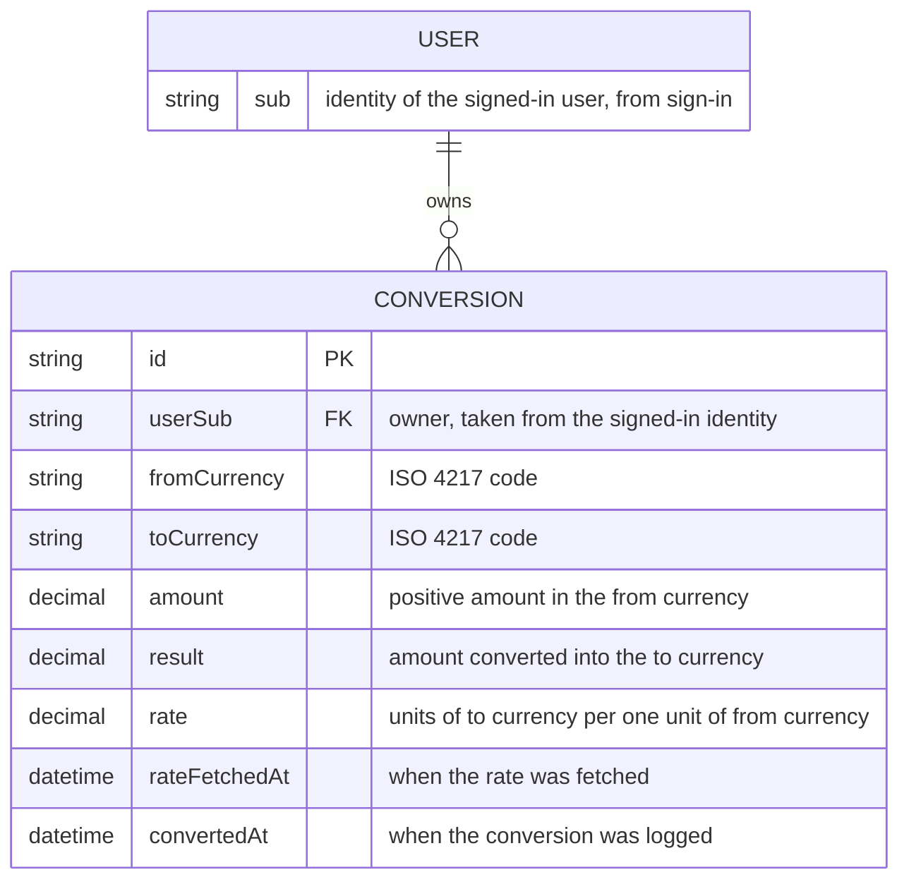

# Data model

The only record the product keeps is the conversion log entry, owned by the signed-in user who made it. Exchange rates are fetched live and are not stored apart from the rate copied into each entry.

- `USER` is not stored by the product; the sign-in service holds it and each entry carries its `sub`.
- Entries are only created and deleted, never edited.